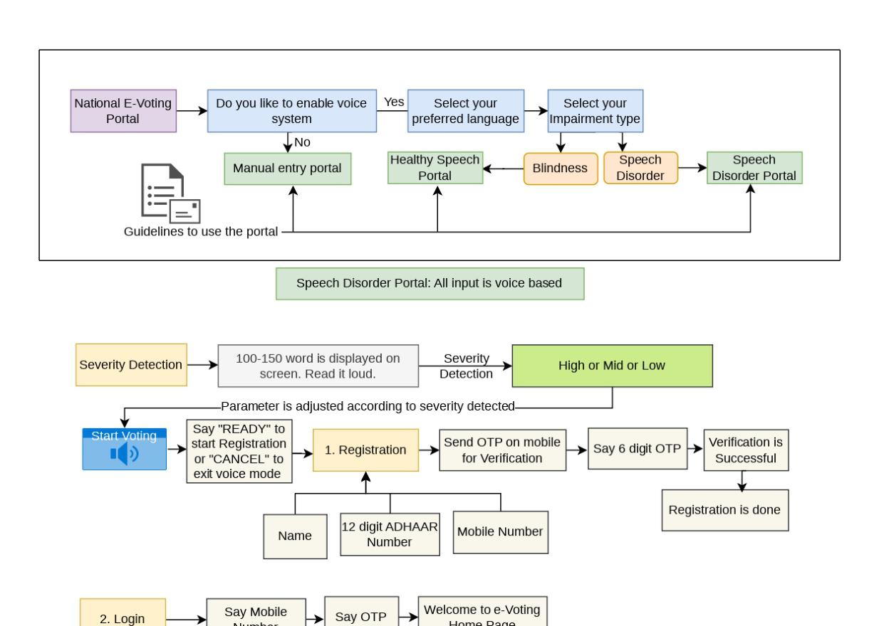
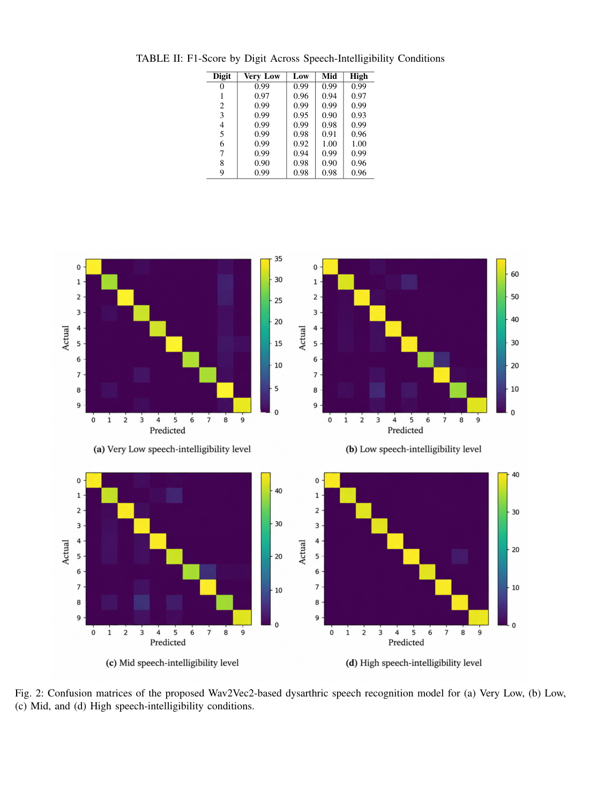
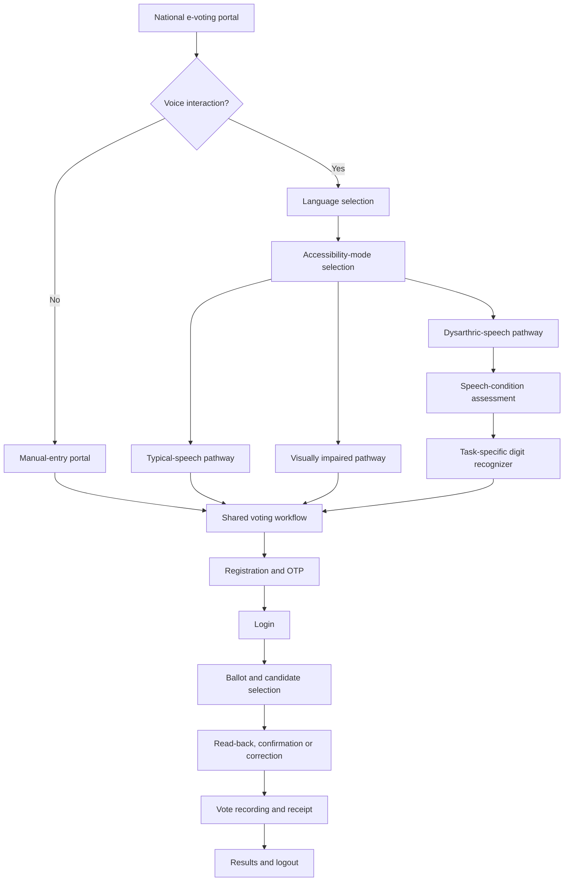

# An Inclusive Voice-Assisted E-Voting Platform with Task-Specific Dysarthric Speech Recognition

<p align="center">
  <strong>An accessibility-focused e-voting research prototype that combines voice-assisted voting with task-specific recognition of dysarthric speech.</strong>
  <br />
  Supporting manual interaction, typical-speech interaction, and a dedicated dysarthric-speech pathway within one shared voting workflow.
</p>

<p align="center">
  
  
  
  
  
</p>

> **Research prototype, not production election infrastructure.** The paper explicitly identifies this as a prototype. The reported speech-recognition results do not establish election-grade security, ballot secrecy, end-to-end verifiability, accessibility conformance, or readiness for real public elections.

---

## Overview

Electronic voting interfaces often assume that voters can use visual controls, touch input, and speech recognizers trained on typical speech. This project explores an alternative: a shared voting workflow with different interaction pathways, including a dedicated pathway for people with dysarthric speech.

The research contribution is a **task-specific dysarthric speech recognizer** built by fine-tuning a pretrained **Wav2Vec2** encoder as a ten-class classifier for spoken digits `0–9`. Instead of attempting open-vocabulary transcription, it focuses on numerical input used by authentication and candidate-number selection. Recognized values are treated as provisional input and routed through confirmation and correction before a vote is finalized.

The paper is titled *An Inclusive Voice-Assisted E-Voting Platform with Task-Specific Dysarthric Speech Recognition*.

## Research highlights

- **Three interaction pathways:** manual entry, typical-speech interaction, and a dysarthric-speech pathway; the overall design also describes a visually impaired user portal with spoken output.
- **Task-specific recognition:** pretrained Wav2Vec2-base fine-tuned for ten numerical classes (`0`–`9`).
- **Four speech-intelligibility conditions:** Very Low, Low, Mid, and High.
- **Confirmation-first interaction:** read-back and correction are built into critical numerical entry and candidate selection.
- **Shared voting logic:** accessibility-specific front ends converge on the same registration, authentication, ballot, confirmation, vote-recording, receipt, and results workflow.
- **Error analysis:** the evaluation reports macro-averaged metrics and confusion matrices, not accuracy alone.

## Reported recognition results

The paper evaluates the digit classifier on isolated digit recordings from the UA-Speech corpus. The test split is held out by recording block, but **it is not speaker-independent**: speakers can occur in both training and test partitions.

| Speech-intelligibility condition | Test samples | Accuracy | Macro precision | Macro recall | Macro F1 |
| --- | ---: | ---: | ---: | ---: | ---: |
| Very Low | 350 | **97.43%** | 0.98 | 0.97 | 0.98 |
| Low | 662 | **96.98%** | 0.97 | 0.97 | 0.97 |
| Mid | 490 | **95.71%** | 0.96 | 0.96 | 0.96 |
| High | 357 | **97.20%** | 0.97 | 0.97 | 0.97 |

These are **isolated-digit classification results**, not complete-OTP accuracy, continuous-speech accuracy, voting task success rates, or evidence of generalization to unseen speakers. The paper notes that performance does not follow a simple monotonic pattern across the four nominal intelligibility conditions and that the class-specific errors differ by condition.

### Research figures

The architecture figure and confusion-matrix figure below are taken from the supplied research paper.

<p align="center">
  
</p>
<p align="center"><em>System architecture and workflow described in the paper.</em></p>

<p align="center">
  
</p>
<p align="center"><em>Confusion matrices reported for the four speech-intelligibility conditions.</em></p>

## System architecture

The paper describes a routing stage followed by modality-specific front ends over a shared voting workflow:

1. A voter chooses manual or voice interaction.
2. For voice interaction, the voter selects language and accessibility mode.
3. The system routes the voter to the relevant interaction pathway.
4. The dysarthric-speech pathway includes a speech-condition assessment stage and a task-specific numerical recognizer.
5. Registration and OTP verification lead to login and the voting home page.
6. Candidate information is presented, and the selected candidate is read back.
7. The voter can confirm or correct the selection before vote recording.
8. A confirmation, notification/receipt flow, results access, and logout complete the journey.

The paper says the speech-condition assessment stage informs recognition settings, but also explicitly notes that this stage was **not independently evaluated** in the reported experiments.



[Editable Mermaid source](docs/diagrams/research-architecture.mmd)

## Dysarthric speech recognition pipeline

The model described in the paper uses:

- **Dataset:** UA-Speech isolated digit recordings.
- **Vocabulary:** ten classes, digits `0` through `9`.
- **Audio preprocessing:** waveform loading and resampling to 16 kHz, then processing with the pretrained Wav2Vec2 processor.
- **Encoder:** pretrained Wav2Vec2-base, with 768-dimensional contextual representations.
- **Pooling:** mean pooling across time to produce one vector for the utterance.
- **Classifier:** fully connected layer with ten outputs.
- **Fine-tuning:** encoder and classification head optimized jointly with cross-entropy loss.
- **Optimization:** Adam, learning rate `1e-5`, batch size `4`.
- **Evaluation:** accuracy, per-class precision/recall/F1, macro-averaged metrics, and confusion matrices.

```mermaid
flowchart LR
    A[UA-Speech isolated digit audio] --> B[Waveform preprocessing]
    B --> C[Resample to 16 kHz]
    C --> D[Wav2Vec2 processor and encoder]
    D --> E[Contextual frame representations]
    E --> F[Mean pooling]
    F --> G[768-dimensional utterance vector]
    G --> H[10-class fully connected head]
    H --> I[Predicted digit 0–9]
    I --> J[Application state and input field]
    J --> K[Read-back, confirmation and correction]
```



[Editable Mermaid source](docs/diagrams/digit-recognition-pipeline.mmd)

## Confirmation and error recovery

The paper treats a recognized digit as an intermediate hypothesis, not an irreversible decision. This matters because one incorrect digit can invalidate an OTP or point to a different candidate.

- Numerical inputs are accumulated in the field currently being collected.
- Candidate selections are read back to the voter.
- The voter can confirm or change the selection before submission.
- Repeat, back, and cancel provide recovery paths through the interaction.
- The model evaluation covers **digits only**; recognition of the full non-numerical voting-command vocabulary is outside the reported experiments.

## Technology

### Application repository

The existing application repository contains a React + TypeScript front end built with Vite, page routing, a shared voice-accessibility context, language context, browser speech APIs, and Supabase client integration.

### Research model

The research paper describes a separate Wav2Vec2-based machine-learning component trained and evaluated on UA-Speech. Do not assume that the published front-end repository contains the model weights, training pipeline, dataset, or an integrated inference service unless those assets are explicitly present in the codebase.

## Getting started

### Prerequisites

- Node.js and npm
- A modern browser for running the front end
- Microphone permission and browser speech-recognition support for browser-based voice interaction
- A Supabase project and the required schema if testing database-connected features

### Run the web application

```bash
git clone https://github.com/anjani24/speech-Aware-Voting-Platform-for-Dysarthric-Users.git
cd speech-Aware-Voting-Platform-for-Dysarthric-Users
npm install
npm run dev
```

The repository's Vite configuration uses port `3000`; open `http://localhost:3000` if that is the port reported by the development server.

For a production build:

```bash
npm run build
```

### Supabase configuration

Review the Supabase client and project configuration under `src/utils/supabase/` and configure your own project and schema before testing database-backed features.

- Never commit private keys, service-role keys, real voter records, or OTPs.
- A browser-exposed anonymous/public key must be paired with appropriate Row Level Security policies.
- UI-level route protection is not a substitute for server-side authorization.
- Use synthetic data only.

## Repository areas

```text
src/
├── components/       # Voter-facing pages, shared UI, and admin screens
├── hooks/            # Page-specific voice-guidance logic
├── utils/
│   ├── i18n/         # Language context and translations
│   └── supabase/     # Supabase client/configuration
├── App.tsx           # Routes and global providers
└── main.tsx          # Application entry point

docs/
├── diagrams/         # Editable Mermaid diagrams
└── images/           # Figures from the supplied research paper
```

This is a high-level map; the exact repository contents may evolve.

## Indian Patent Office publication

The project team has provided a record of publication by the Indian Patent Office for an invention related to this work.

| Field | Details |
| --- | --- |
| **Invention title** | SECURE, MULTILINGUAL AND ADAPTIVE E-VOTING INDIAN PLATFORM WITH DYSARTHRIC SPEECH RECOGNITION FOR IMPAIRED VOTERS |
| **Publication number** | 21/2026 |
| **Publication date** | 22 May 2026 |
| **Publication type** | INA |
| **Application number** | 202611046473 |
| **Application filing date** | 10 April 2026 |
| **Field of invention** | Electronics |
| **IPC classification** | G07C 13/00, G10L 17/00, G10L 15/26, G10L 15/22, G06Q 50/26 |
| **Inventors listed in the supplied record** | Dr. Komal Bharti, Dr. Nitin Arora, Tatvam Jain, Anjani Agarwal, Sanchita Sharma |

These details are transcribed from the Indian Patent Office record screenshot supplied with the project materials. For formal citation, verify the entry against the official Indian Patent Office database and link the exact record when available.

**Important:** publication is not the same as grant. This README records the publication details supplied by the project team and does not claim that the patent has been granted.

## Research limitations

The paper explicitly identifies the following limitations:

- Evaluation uses isolated numerical speech from UA-Speech rather than continuous, spontaneous, or conversational speech.
- The held-out evaluation is recording-level, not speaker-independent.
- The reported results do not cover the complete multi-digit OTP or identification-number sequence as a single recognition task.
- Realistic noise, reverberation, microphone variation, and changing recording conditions have not been evaluated.
- Recognition of non-numerical voting commands is outside the reported experiments.
- The speech-condition assessment stage is not independently evaluated.
- A large-scale user study with people across different levels of speech impairment has not been conducted.
- The application is a research prototype, not electoral infrastructure; formal security analysis, independent audit, cryptographic guarantees, threat modelling, and regulatory compliance would be needed before any real-world election use.

## Future work identified in the paper

- Evaluate with unseen speakers using speaker-independent data splits.
- Measure complete-sequence accuracy, correction rate, and attempts required for multi-digit entry.
- Extend recognition to non-numerical voting commands and continuous speech.
- Test robustness to background noise, reverberation, microphone differences, and speaking-rate variation.
- Investigate confidence estimation, re-prompting, augmentation, and speaker adaptation.
- Conduct user studies measuring task completion, interaction time, correction frequency, workload, and satisfaction.
- Assess privacy, security, accessibility conformance, additional Indian languages, and resource-constrained devices.

## Citation

**Paper title:** *An Inclusive Voice-Assisted E-Voting Platform with Task-Specific Dysarthric Speech Recognition.*

If you publish or distribute this project, add the paper's author list, venue, year, DOI or public paper URL when those details are finalized. They were not included in the supplied PDF text provided for this README.

## Responsible use

Use this repository for research, demonstration, and accessibility prototyping. Do not use it to conduct a real election or to collect real Aadhaar numbers, OTPs, or voter records. The reported digit-classification accuracy must not be presented as overall voting-system accuracy or as a guarantee that a real voter's choice will be recognized correctly.

## License

No license is specified in the repository at the time this README was prepared. Until a license is added, do not assume the code is available for unrestricted reuse.
